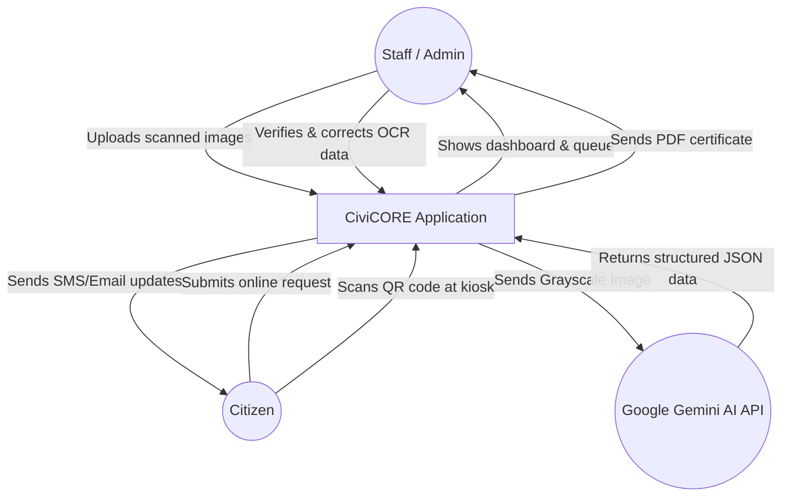
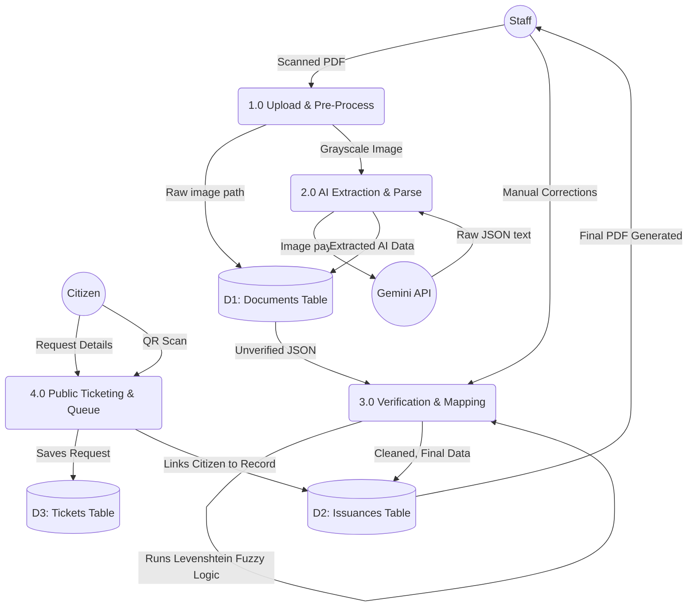

# CiviCORE - Comprehensive System Architecture & Engineering Documentation

## 1. System Overview

**CiviCORE** is an advanced Civic Document Management and Civil Registry Platform developed for Local Government Units (LGUs). The system accelerates the digitization of civil registry records, streamlines citizen service requests via QR code ticketing, enforces strict data privacy and retention policies, provides geospatial demographic analytics, and guarantees point-in-time disaster recovery with zero data loss.

---

## 2. Technology Stack & Key Dependencies

### 2.1 Backend Architecture
- **Framework**: Laravel 12.x
- **Runtime**: PHP 8.2+
- **Database**: MySQL 8.0+ / MariaDB 10.4+ (with SQLite support for isolated environments)
- **Queue System**: Laravel Database Queue Worker (`high`, `low`, `default` queues)
- **Task Scheduler**: Laravel Artisan Console Scheduler (`routes/console.php`)
- **Key Backend Packages**:
  - `google-gemini-php/client` / Gemini API REST client for multimodal document parsing
  - `simplesoftwareio/simple-qrcode` for dynamic SVG/PNG QR code ticket generation
  - `maatwebsite/excel` / `phpoffice/phpspreadsheet` for Excel report generation

### 2.2 Frontend Architecture
- **Library**: React 19
- **Build Tool**: Vite 7.x
- **Styling**: Tailwind CSS 4.x
- **Animation**: Framer Motion
- **Icons**: Heroicons v2 (`@heroicons/react`)
- **GIS Mapping**: Leaflet.js (`react-leaflet`) with custom GeoJSON boundaries for Naic barangays
### 2.3 OCR & AI Vision Architecture
- **Daemon / Bridge**: Python FastAPI (`ocr_server.py`) running on `http://127.0.0.1:8080`
- **Cloud Engine**: Google Gemini API (`gemini-2.5-flash`) via `google-genai` with multi-key cooldown rotation
- **Local / Offline Engine**: **Ollama** running `qwen2.5vl:3b` on `http://127.0.0.1:11434` for 100% offline, zero-leakage municipal data privacy
- **Computer Vision**: OpenCV (`cv2`) & NumPy for registrar signature isolation; PyMuPDF for PDF page rasterization; Pillow for dynamic scaling (768px for CPU/Ollama, 1024px for Gemini).

---

## 3. Core Modules & Implementation Details

### 3.1 Dual-Engine AI OCR Pipeline (`OcrFormPanel.jsx`, `ocr_server.py`, `SettingController.php`)
- **Engine Options**:
  - **Google Gemini Cloud AI (`gemini-2.5-flash`)**: High-throughput multimodal parsing with automated cooldown management across comma-separated API keys (`GEMINI_API_KEYS`).
  - **Local Ollama Vision AI (`qwen2.5vl:3b`)**: On-premise air-gapped vision model processing documents completely offline with zero external network dependency, ensuring strict data residency compliance for citizen records.
- **Dynamic Resolution Optimization**:
  - Input images are automatically scaled to 768px when executing via Local Ollama (optimizing CPU cache and memory overhead) and 1024px when executing via Gemini Cloud.
- **Real-Time Health Monitoring & Engine Toggle**:
  - SuperAdmin control panel at `/accounts` provides single-click engine toggling.
  - Endpoint `/api/settings/ocr-status` performs live ping checks against Ollama (`http://127.0.0.1:11434/api/tags`), inspects installed models, and displays real-time `Offline / Private` visual badges.
- **Supported Form Types**:
  - **LCR Form 102 (Certificate of Live Birth)**: Extracts registry number, child full name, gender, date of birth, time of birth, place of birth, parents' full names and demographics, marriage of parents, attendant details, and informant.
  - **LCR Form 103 (Certificate of Death)**: Extracts registry number, deceased full name, date of death, place of death, age, marital status, citizenship, immediate/antecedent/underlying causes of death, and medical certifier.
  - **LCR Form 101 (Certificate of Marriage)**: Extracts registry number, contracting parties (husband & wife), citizenship, residence, parents, solemnizing officer, license number, and marriage date.
- **Resilient Date Normalization (`normalizeDateToYMD`)**:
  - Implements timezone-safe parsing on the client side to avoid the UTC date-shift bug (e.g. converting local calendar dates to a previous day).
  - Handles formats: `YYYY-MM-DD`, `MM/DD/YYYY`, `M/D/YYYY`, ISO 8601 strings, and written textual dates.
- **Name Standardization**:
  - Automatically enforces uppercase styling across all name inputs.
  - Enforces `LASTNAME, FIRSTNAME MIDDLENAME [SUFFIX]` format for individual records and `HUSBAND & WIFE` format for marriages.

### 3.2 Scanned Image Post-Processing Studio (`ImagePostFxModal.jsx`)
- **Purpose**: Gives registrars complete in-browser control to clean up degraded or crooked paper scans prior to saving or OCR ingestion.
- **Capabilities**:
  1. **90° Step Lossless Rotation**: 0°, 90°, 180°, and 270° orientation corrections.
  2. **Binarization Filter (Black & White)**: Dynamic high-contrast threshold filter optimized for carbon copies, faint ink, and yellowed paper to improve OCR character extraction accuracy.
  3. **Interactive 4-Corner Crop & Perspective Framing**: User can drag 4 corner control handles on top of the preview canvas to adjust document framing.
  4. **Canvas Pipeline**: Generates an optimized image `Blob` directly in the browser and feeds it into the document attachment queue.

### 3.3 Automated Backup & Disaster Recovery Architecture (`BackupService.php`, `Backups.jsx`)
- **Service Layer**: `App\Services\BackupService`
  - Creates timestamped ZIP archives containing `database.sql` (or SQLite database), `files/*` (all physical files from `storage/app/public`), and `manifest.json`.
  - Enforces strict private file permissions (`0700`) outside the public web root in `storage/app/backups/`.
- **Scheduled Automated Backups**:
  - **Daily**: 2:00 AM (7-day retention).
  - **Weekly**: Sunday 3:00 AM (4-week retention).
  - **Monthly**: 1st of the month at 4:00 AM (6-month retention).
  - **Semi-Annual**: Jan 1 and Jul 1 at 5:00 AM (2-year retention).
  - **Auto-Pruning**: Daily at 6:00 AM via `backup:prune`.
- **Point-in-Time Restoration & Safety Guard**:
  - Prior to executing any restore, the system automatically creates a `pre_restore` backup snapshot of current live data.
  - Restoration runs inside a managed transaction and restores both SQL tables and physical storage files.
- **SuperAdmin Web Console (`/backups`)**:
  - Table of all backup packages with status, retention category, file count, and byte size.
  - Manual backup generation modal.
  - Safe restoration modal requiring the operator to type `CONFIRM RESTORE` before proceeding.
  - Direct browser downloads are blocked to prevent unauthorized data exfiltration.
- **Emergency CLI Disaster Recovery Script (`civicore_backup_recovery.bat`)**:
  - Provides a standalone Windows CLI menu for disaster recovery when the web server is offline.

### 3.4 User Account Management & Zero Data Loss Policy (`UserController.php`, `Accounts.jsx`)
- **Schema**: `users.is_active` (boolean, indexed).
- **Soft-Disable Architecture**:
  - Standard user deletion is replaced with soft account deactivation (`is_active = false`).
  - Preserves all historical linkages: documents created, issuances approved, and activity audit logs are never orphaned.
  - SuperAdmin self-disablement is prohibited at the controller level.
- **Session Revocation**:
  - Upon deactivating a user, all active sessions in the `sessions` table are immediately deleted.
  - Middleware (`RequireSessionAuth`) and `AuthController` reject deactivated users with HTTP 403.
- **Web UI (`Accounts.jsx`)**:
  - Active and Disabled filter tabs.
  - Visual status badges and quick-toggle action buttons with confirmation modals.

### 3.5 Unified High-Aesthetic Pagination System (`Pagination.jsx`)
- **Component**: `resources/js/components/Pagination.jsx`
- **Features**:
  - Responsive desktop and mobile layout with accessible ARIA tags.
  - Page size selector (`10`, `25`, `50` records).
  - Smart numeric ellipsis pagination (`1, 2, ..., 7, 8, 9, ..., 20`).
  - Dynamic item counters (`Showing 1 to 10 of 48 records`).
- **Standardized Implementations**:
  - `Documents.jsx` (Civil Registry Documents)
  - `Issuances.jsx` (Approved Certificate Issuances)
  - `PendingRequests.jsx` (Citizen Ticket Queue)
  - `ArchiveManager.jsx` (Archived & Soft-Deleted Records)
  - `Reports.jsx` (Export Preview Table)
  - `Accounts.jsx` (User Management)

### 3.6 Citizen QR Code Ticketing & Queue Management (`PendingRequests.jsx`, `TicketScannerModal.jsx`)
- **Public Request Portal (`/request`)**:
  - Citizens choose certificate type (Birth, Marriage, Death), provide recipient information, and submit requests without requiring an account.
  - System generates a unique tracking number (`REQ-YYYYMMDD-XXXX`) and QR code.
- **Status Endpoint (`/ticket-status/{ticket_number}`)**:
  - Allows citizens to check live request progress via mobile device.
- **Staff Operations & Countertop Scanner**:
  - Real-time queue view with status progression: `Pending` $\rightarrow$ `Serving` $\rightarrow$ `Completed` $\rightarrow$ `Issued`.
  - Built-in webcam QR scanner modal allows staff to scan tickets directly from citizens' phones or printed stubs.
  - Seamless document attachment (`AttachDocumentModal.jsx`) links registry files to fulfilled tickets.

### 3.7 Geospatial Demographic Mapping Dashboard (`Mapping.jsx`)
- **Interactive Map**: Geofenced to Naic, Cavite with barangay polygons.
- **Analytics Overlays**:
  - Heatmap density overlay based on document concentration.
  - Birth-to-Death demographic ratio indicators per barangay.
  - Leaderboard showing top barangays by document volume.
- **Temporal Filtering**: All Time, Today, This Week, This Month, This Year, or Custom Date Interval.

### 3.8 Custom Reporting & Export Suite (`Reports.jsx`)
- **Export Engines**: Native CSV and Microsoft Excel (`.xlsx`).
- **Filter Parameters**:
  - Date range (From / To).
  - Record category (Issuances, Documents, Service Requests).
  - Certificate type (Birth, Death, Marriage).
  - Lifecycle status.
  - Barangay jurisdiction.
- **Live Summary Metrics**: Real-time counter of matching records, distribution breakdown, and formatted data preview table.

---

## 4. API Endpoints Reference

### 4.1 Authentication & Profile
| Method | Endpoint | Access Level | Description |
|---|---|---|---|
| `POST` | `/api/auth/login` | Public | Authenticates user; validates `is_active` status. |
| `POST` | `/api/auth/logout` | Authenticated | Clears current session and cookies. |
| `GET` | `/api/auth/session` | Authenticated | Validates session token; returns active user object. |
| `PUT` | `/api/users/{id}/profile` | Authenticated (Self) | Updates avatar, contact details, and display preferences. |

### 4.2 Document & OCR Operations
| Method | Endpoint | Access Level | Description |
|---|---|---|---|
| `GET` | `/api/documents` | Staff / Admin | Lists civil registry documents with pagination and filters. |
| `POST` | `/api/documents` | Staff / Admin | Creates a new civil registry document record. |
| `POST` | `/api/documents/ocr` | Staff / Admin | Submits scanned file/image to Gemini AI for OCR field extraction. |
| `GET` | `/api/documents/{id}` | Staff / Admin | Retrieves detailed document metadata and scan asset URL. |
| `PUT` | `/api/documents/{id}` | Staff / Admin | Updates extracted or verified document fields. |
| `DELETE` | `/api/documents/{id}` | Staff / Admin | Soft-deletes document to archive. |

### 4.3 QR Ticketing & Queue Management
| Method | Endpoint | Access Level | Description |
|---|---|---|---|
| `POST` | `/api/tickets` | Public | Submits a new citizen document request. |
| `GET` | `/api/tickets/{ticket_number}` | Public | Retrieves public request status and QR code payload. |
| `GET` | `/api/tickets` | Staff / Admin | Lists queue tickets with status filtering. |
| `PUT` | `/api/tickets/{id}/status` | Staff / Admin | Updates ticket lifecycle state (`Pending`, `Serving`, `Completed`, `Issued`). |
| `POST` | `/api/tickets/{id}/attach-document` | Staff / Admin | Attaches an approved registry document to a ticket. |

### 4.4 User & Role Management
| Method | Endpoint | Access Level | Description |
|---|---|---|---|
| `GET` | `/api/users` | Admin / SuperAdmin | Lists system users with role and status indicators. |
| `POST` | `/api/users` | Admin / SuperAdmin | Creates a new staff or admin user account. |
| `PUT` | `/api/users/{id}` | Admin / SuperAdmin | Updates account information and role assignments. |
| `POST` | `/api/users/{id}/toggle-status` | SuperAdmin | Enables or disables user account without data loss. |
| `DELETE` | `/api/users/{id}` | Admin / SuperAdmin | Safely disables account (soft-deletion). |

### 4.5 System Backup & Disaster Recovery
| Method | Endpoint | Access Level | Description |
|---|---|---|---|
| `GET` | `/api/backups` | SuperAdmin | Lists all available system backup archives and metadata. |
| `POST` | `/api/backups` | SuperAdmin | Triggers an immediate full system backup. |
| `POST` | `/api/backups/restore` | SuperAdmin | Restores system state from selected archive. |

---

## 5. Security Architecture & Disaster Recovery Plan

### 5.1 Air-Gapped Storage & Data Protection
- Backup archives are stored in `storage/app/backups/` outside the public web root.
- Web server configurations block direct HTTP/HTTPS access to storage directories.
- Download endpoints for database dumps are omitted to prevent data leakage.
- Passwords are encrypted using bcrypt hashing (`Hash::make`).

### 5.2 Zero Data Loss Account Deactivation
- Physical database rows in the `users` table are never purged when deactivating personnel.
- All historical issuance records, receipts, and activity audit logs remain tied to the originating user ID.
- Inactive users are rejected by the authentication guard and middleware.

### 5.3 Disaster Recovery Runbook
In the event of a catastrophic server or database failure:

1. **Option A: Web Console Recovery (If Web UI is accessible)**
   - Log in as SuperAdmin.
   - Navigate to **System Backups** (`/backups`).
   - Identify the desired snapshot from the backup list.
   - Click **Restore**, review the confirmation warning, type `CONFIRM RESTORE`, and submit.
   - A safety pre-restore snapshot will be generated automatically before database and file replacement.

2. **Option B: CLI Recovery (If Web UI is offline)**
   - Open Command Prompt / PowerShell as Administrator.
   - Navigate to the repository directory:
     ```cmd
     cd C:\laragon\www\civicore_laravel
     ```
   - Run the recovery utility:
     ```cmd
     civicore_backup_recovery.bat
     ```
   - Select `[1]` to view backup archives.
   - Select `[3]` and enter the desired backup filename (e.g. `civicore_daily_20261008_020000.zip`).
   - The utility will safely restore the database and physical attachments.

---

## 6. Maintenance & Verification Checklist

- **Daily Schedule Verification**: Verify scheduled tasks are running (`php artisan schedule:run`).
- **Storage Link Verification**: Ensure `public/storage` symlink points to `storage/app/public`.
- **Gemini OCR Verification**: Verify `GEMINI_API_KEY` in `.env` is valid and has active quota.
- **Vite Build Verification**: When updating frontend components, run `npm run build` to compile production assets.

---

# System Architecture & Data Flow Guide

This document provides a comprehensive, start-to-finish explanation of how your system operates. This is your "Master Guide" for the defense, connecting all the pieces of the system together and justifying your technical decisions.

---

## 1. The Tech Stack: "Why did we use these technologies?"
Expect the panelists to ask you why you chose your specific tools. Here is how you answer them confidently:

*   **Why Laravel (Backend)?** 
    *   *Answer:* Laravel is the most robust PHP framework available. We chose it because it provides built-in, secure solutions for routing, database migrations, and authentication. Instead of writing raw SQL and risking security vulnerabilities, Laravel's Eloquent ORM allows us to interact with the database securely and rapidly. It also natively supports API creation, which is essential for our React frontend.
*   **Why React (Frontend)?** 
    *   *Answer:* Traditional websites reload the entire page every time you click a button. We chose React to build a **Single Page Application (SPA)**. React only updates the specific parts of the screen that change (like a progress bar or an OCR panel sliding in). This provides a fast, seamless, "desktop-app-like" experience for the registry staff, which is critical when they are processing hundreds of documents a day.
*   **Why TailwindCSS (Styling)?** 
    *   *Answer:* Tailwind is a utility-first CSS framework. Instead of maintaining thousands of lines in separate `.css` files, Tailwind allows us to style components directly in our React files using utility classes. This guarantees consistency across the UI, makes it incredibly easy to implement our "Glassmorphism" design, and ensures the application is perfectly responsive on all screen sizes.
*   **Why Gemini AI (OCR Engine)?**
    *   *Answer:* Standard OCR tools (like Tesseract) only read text blindly—they don't understand *context*. We integrated Google's Gemini AI because it is a multimodal Large Language Model (LLM). When we feed it a scanned, messy Birth Certificate, Gemini doesn't just read the words; it *understands* the document structure. It can accurately distinguish between the "Father's Name" and the "Doctor's Name" even if the paper is faded or slightly misaligned, returning perfectly structured JSON data.

---

## 2. The Data Flow: "How does data move through the system?"
Let's trace the journey of a document from the moment it is scanned until it is saved in the database.

### Step A: The Upload (React to Laravel)
1. A staff member opens the **Documents** page in React and uploads a scanned PDF or Image.
2. The code in `resources/js/components/Documents.jsx` (specifically around **Line 295**) uses the `fetch` API to send a `POST` request with the file data to the backend.
3. The request hits `routes/api.php` (at **Line 78**), which routes the `/api/documents/upload` endpoint to the `DocumentController`.
4. In `app/Http/Controllers/DocumentController.php` (starting at **Line 246**), the `upload` method validates the file. It saves the physical file to the local storage disk (around **Line 294**), creates a `Pending` database record, and then queues the background OCR job (at **Line 316**).

### Step B: The AI Extraction (Laravel to Python/Gemini)
1. The background job `app/Jobs/ProcessDocumentOcr.php` picks up the file. At **Line 140**, it sends an HTTP POST request containing the file path to our Python server (`http://127.0.0.1:8080/ocr/gemini`).
2. **Pre-Processing (The Python Server - `ocr_server.py`):**
    * If the uploaded file is a PDF, the Python server hits the `/split` endpoint (around **Line 954**). It uses `PyMuPDF (fitz)` to extract the first page (ignoring the rest to save Gemini API token costs).
    * It converts the image to grayscale (`convert("L")`) to strip out unnecessary color data and compresses it using Lanczos resampling. This makes the image smaller and easier for the AI to read quickly.
3. **The Gemini AI Engine:**
    * The Python server packages the optimized, black-and-white image and sends it to the **Google Gemini API** using the `google-genai` module.
    * The prompt sent to Gemini instructs it to act as a civil registry expert and extract specific fields into a strict JSON format.
4. Gemini processes the image, understands the context, and replies with structured data.
5. **Post-Processing & Cleanup:**
    * Before returning to Laravel, the Python server cleans the data: it splits full names into First, Middle, and Last names, and normalizes date formats.
    * Back in Laravel, `ProcessDocumentOcr.php` (around **Line 165**) runs an additional `OcrParserService` as a fallback, merging any missing fields.
    * Finally, Laravel updates the database record with the extracted fields and changes the document status to `extracted` (around **Line 250**).

### Step C: The Verification (Laravel to React)
1. React polls the status, notices it is `extracted`, and slides open the **`OcrFormPanel.jsx`** component.
2. The user sees the original scanned image on the left and the Gemini-extracted text populated in editable textboxes on the right.
3. The staff member visually verifies that the AI didn't make a mistake (e.g., verifying that an "8" wasn't misread as a "B").

### Step D: Saving the Data (React to Laravel to Database)
1. Once the staff clicks "Save", React sends the verified data via a `PUT` request to `/api/documents/{id}`.
2. **The Mapping Logic happens here:** On the frontend, `Mapping.jsx` implements `findClosestBarangay` using Levenshtein distance. If Gemini extracted *"Bgy. San Jse"*, the algorithm compares it against our master list of strict barangays and automatically snaps it to the closest match: *"San Jose"*. This ensures the data going to the backend is clean.
3. The request hits `app/Http/Controllers/DocumentController.php` (at **Line 555**, `update` method).
4. This calls the `performSave` method (at **Line 731**), which updates the document's final data, status (`Processed` or `Issued`), and automatically generates a composite PDF of the record.

---

## 3. The Ticketing System Flow
If the panelists ask about the online public request feature, here is the detailed flow of how it works under the hood:

1. **Submission (Public to Laravel):** A citizen goes to the public portal and requests a certificate. This sends a `POST` request to `/api/v1/tickets`.
2. **Ticket Generation (`TicketController.php`):** The `store` method (around **Line 60**) handles this. It generates a unique Tracking Number (e.g., `T-2026-0001`) and a randomized 40-character token. It also uses the `QrCode` facade to generate an SVG QR Code (around **Line 88**) and saves the ticket as `pending`. An email is then dispatched via the `TicketConfirmation` Mail class.
3. **Kiosk Check-In:** When the citizen arrives at the office, they scan their QR code at the Kiosk. This sends a `POST` request to `/api/v1/tickets/scan`.
4. **Queue Assignment (`TicketController.php`):** The `scanCheckIn` method (around **Line 607**) verifies the QR token. If valid, it assigns them a `queue_number` starting at 101 for the day, and changes their `queue_status` to `waiting` (around **Line 666**). They now appear on the staff's `LobbyQueue.jsx` dashboard screen.
5. **Document Attachment (Staff):** The staff searches the master registry for the citizen's record and links it to the ticket via a `PATCH` request to `/api/v1/tickets/{id}/attach`.
6. **Syncing Issuances (`TicketController.php`):** The `attachDocument` method (around **Line 460**) changes the ticket status to `ready_for_pickup`. Crucially, it triggers the `syncIssuanceWithTicket` method (at **Line 531**), which automatically generates a new record in the `issuances` table (the master registry), merging the citizen's form inputs with the stored OCR data.
7. **Final Issuance:** Once the physical document is printed and handed to the citizen, the staff clicks "Issue". This hits the `issueDocument` method (around **Line 690**), permanently marking the ticket as `completed` and removing them from the lobby.

---

## 4. Authentication & Security (Login Flow)
If the panelists ask about how user login works and how passwords are secured, explain this flow:

1. **The Login Request:** The user types their email and password in React. This sends a `POST` request to `/api/login`.
2. **The Controller (`AuthController.php`):** The request is routed to the `login` method (around **Line 15**).
3. **Password Encryption & Verification:** 
    * We NEVER store plain-text passwords in the database. When a user is created, their password is encrypted using Laravel's **Bcrypt** hashing algorithm (via the `Hash::make()` facade). Bcrypt is an industry-standard, one-way hash that includes a "salt" to protect against rainbow table attacks.
    * During login, at **Line 31** (`Hash::check($request->input('password'), $user->password)`), the system takes the plain-text input, runs it through the Bcrypt algorithm, and compares the resulting hash against the hash stored in the database. 
4. **Session Management:**
    * If the password matches, we do NOT use vulnerable JWT tokens that are exposed in the browser's LocalStorage.
    * Instead, at **Line 39**, we use Laravel's secure session manager: `$request->session()->put('user_id', $user->id);`.
    * This creates a secure, **HTTP-only cookie** on the user's browser. HTTP-only means malicious JavaScript (XSS attacks) cannot steal the login session. 
    * For every subsequent request, Laravel automatically reads this cookie to verify the user's identity via the `session` endpoint (Line 50).

---

# Data Flow Diagram (DFD)

A Data Flow Diagram (DFD) maps out the flow of information for any process or system. Below are two levels of DFDs representing the CiviCORE system, written in Mermaid syntax.

> [!TIP]
> The diagrams below use Mermaid syntax. If you are viewing this in a markdown viewer that supports Mermaid (like GitHub or many code editors), it will render as a beautiful visual graphic. If not, the text structure perfectly explains the data flow!

---

## Level 0 DFD: Context Diagram
This is a high-level view showing the entire CiviCORE system as a single process and how external entities (Citizens, Staff, and APIs) interact with it.



---

## Level 1 DFD: Sub-Process Breakdown
This breaks down the "CiviCORE Application" from the Context Diagram into the actual internal processes and data stores (tables).



## How to Explain This DFD to the Panel:

1.  **Level 0 (Context):** Keep it simple. "Our system interacts with three main outside actors: The Staff, The Citizen, and the Google Gemini API. Data flows in through uploads and forms, and flows out as PDFs and structured JSON."
2.  **Level 1 (Sub-Process):** Point to the 4 main processes. 
    *   **Process 1.0:** The staff uploads the file, and we pre-process it to grayscale. It hits the `Documents` table.
    *   **Process 2.0:** We send it to Gemini, and Gemini gives us JSON back.
    *   **Process 3.0:** The staff looks at the JSON side-by-side with the image. When they click save, our Fuzzy Logic algorithm corrects the Barangay names, and the data is finalized into the `Issuances` table.
    *   **Process 4.0:** A citizen requests a document online. The system creates a Ticket, links it to the final Issuance, and generates the physical copy for printing.

---

# Bootstrap and Config Directories Overview

These two folders (`bootstrap/` and `config/`) are responsible for setting up the environment and dictating how your application behaves before any user request is even processed. While you rarely need to edit the files in `bootstrap`, the `config` folder is where you define the major settings of your system.

Here is the file-by-file breakdown for your defense.

---

## 1. The `bootstrap/` Directory
Think of this directory as the "ignition switch" or the "starter motor" of your application. When a request comes into your server, this is the very first code that runs to wake the system up.

*   **`app.php`**
    *   **What it does:** This is the main bootstrapping file (especially critical in Laravel 11). It initializes the application instance, registers core routing files (`web.php`, `api.php`), configures global middleware (like CSRF protection or CORS), and sets up exception handling.
    *   **Why it's important:** Without this file, the framework cannot start. If you ever need to add a global middleware that runs on *every single request*, you configure it here.
*   **`providers.php`**
    *   **What it does:** Returns an array of service providers that should be loaded automatically by the framework.
    *   **Why it's important:** Service providers are the central place where your application is bootstrapped (where services are bound to the container). This file tells Laravel which providers to wake up.
*   **`cache/` (Folder)**
    *   **What it does:** Contains framework-generated files (like `packages.php` and `services.php`) that Laravel creates automatically to optimize performance. 
    *   **Why it's important:** Instead of reading massive configuration files from scratch every time a user loads a page, Laravel caches the results here. This makes your application run significantly faster. **Note:** You should never manually edit files inside this cache folder; they are auto-generated.

---

## 2. The `config/` Directory
This directory contains all the configuration files for your application. It acts as the "control panel" where you adjust settings for database connections, email servers, caching mechanisms, and more. Most of these files pull values from your hidden `.env` file for security.

*   **`app.php`**
    *   **What it does:** Contains general application settings like the timezone (e.g., `Asia/Manila`), the application environment (`local` vs `production`), application name, and the "key" used for encryption.
    *   **Why it's important:** The encryption key configured here is what keeps your user sessions and passwords secure. The timezone setting ensures that when you save an issuance, the `created_at` timestamp reflects Philippine time, not server default time.
*   **`auth.php`**
    *   **What it does:** Configures the authentication guards and providers. It tells Laravel how users should be logged in (e.g., via session cookies) and which database table holds the user accounts (`users` table).
    *   **Why it's important:** It is the backbone of your login system. Without it, the application wouldn't know how to verify if an admin is actually an admin.
*   **`cache.php`**
    *   **What it does:** Configures how the system caches data to improve speed. It defines whether cache should be saved as files, in a database, or using an in-memory tool like Redis.
    *   **Why it's important:** Proper caching prevents your server from crashing under heavy load. For CiviCORE, it dictates where temporary data is stored quickly.
*   **`cors.php`**
    *   **What it does:** Cross-Origin Resource Sharing (CORS) settings. It determines which external websites or domains are allowed to talk to your Laravel backend.
    *   **Why it's important:** This is a crucial security feature. Since your frontend (React/Vite) and backend (Laravel/Python OCR) might run on different ports during development or production, CORS rules dictate whether they are allowed to share data.
*   **`database.php`**
    *   **What it does:** Contains the connection settings for your MySQL database (hostname, port, database name, username, password).
    *   **Why it's important:** This is the bridge to your actual data. If this file is misconfigured, the entire system goes down with a "Database Connection Error".
*   **`filesystems.php`**
    *   **What it does:** Configures your storage "disks". It defines where uploaded files (like scanned PDFs or generated certificates) should be saved—whether locally on the server's hard drive or on cloud storage like Amazon S3.
    *   **Why it's important:** Your system heavily relies on archiving documents. This file ensures that when an OCR image is uploaded or a PDF is generated, it lands safely in the `storage/app/public` folder.
*   **`logging.php`**
    *   **What it does:** Configures how and where error messages are saved. By default, it saves them to `storage/logs/laravel.log`.
    *   **Why it's important:** If the system crashes or encounters a 500 Server Error (like the OCR issue you recently fixed), this config determines where the error details are written so you can fix them.
*   **`mail.php`**
    *   **What it does:** Configures your email sending service (SMTP details, Mailtrap, or Gmail configurations).
    *   **Why it's important:** Powers your ticket confirmation emails and verification codes. If this isn't set up correctly, citizens won't receive their tracking numbers.
*   **`queue.php`**
    *   **What it does:** Configures background job queues. It tells Laravel how to handle tasks that take too long (like OCR processing).
    *   **Why it's important:** Crucial for user experience. Because OCR takes time, this config allows the system to process the document in the background without freezing the user's browser.
*   **`services.php`**
    *   **What it does:** Stores credentials for third-party services (e.g., Stripe, Mailgun, or AWS).
    *   **Why it's important:** Provides a safe, centralized place to store API keys for external integrations so they aren't hardcoded randomly throughout the system.
*   **`session.php`**
    *   **What it does:** Configures how user sessions are stored (in files, cookies, or the database) and how long a user can remain idle before being automatically logged out.
    *   **Why it's important:** Essential for security. It controls the "Remember Me" functionality and ensures that inactive admin sessions expire properly to prevent unauthorized access.

---

# Application Directory (`app/`) Overview

The `app` folder is the heart of your Laravel backend. It contains the core logic of the system, including how requests are handled (Controllers), how data is structured (Models), background tasks (Jobs), emails (Mail), and reusable logic (Services). 

Here is a detailed, file-by-file breakdown of everything inside the `app/` directory to help you ace your defense tomorrow.

---

## 1. `app/Http/Controllers/`
Controllers act as the "middleman" between your frontend (React) and your database. When a user clicks a button or loads a page, a route sends that request to a specific controller function to process it.

*   **`ActivityLogController.php`**
    *   **What it does:** Fetches the history of user actions (like who printed a certificate or who deleted a file).
    *   **Importance:** Essential for system auditing and accountability, allowing admins to track what users are doing inside the system.
*   **`AnnouncementController.php`**
    *   **What it does:** Manages the creation, updating, deletion, and fetching of announcements/bulletins.
    *   **Importance:** Powers the announcement board on the dashboard, keeping users informed about system updates or office news.
*   **`AuthController.php`**
    *   **What it does:** Handles user login, logout, and session management.
    *   **Importance:** Critical for security. It verifies usernames and passwords and ensures that only authorized personnel can access the system.
*   **`BarangayController.php`**
    *   **What it does:** Manages the list of barangays (fetching, adding, editing).
    *   **Importance:** Used in dropdowns and forms throughout the system to standardize the input of addresses.
*   **`Controller.php`**
    *   **What it does:** The base controller class provided by Laravel.
    *   **Importance:** All other controllers extend this file. It provides foundational methods used by the entire controller system.
*   **`DashboardController.php`**
    *   **What it does:** Calculates and gathers the statistics shown on the main dashboard (e.g., total issuances, pending tickets, recent activities).
    *   **Importance:** Gives the users a quick, high-level summary of the system's current state as soon as they log in.
*   **`DocumentController.php`**
    *   **What it does:** Handles the uploading, archiving, retrieving, and deletion of scanned documents.
    *   **Importance:** This is the core of the digital archiving feature. It manages where physical files are stored digitally and links them to database records.
*   **`IssuanceController.php`**
    *   **What it does:** Manages civil registry issuances (Birth, Marriage, Death certificates). It handles saving extracted OCR data, updating records, generating PDF certificates, and managing print approvals.
    *   **Importance:** This is arguably the most important file for the core business logic of generating and issuing certificates.
*   **`OcrController.php`**
    *   **What it does:** Receives uploaded images and sends them to the Python OCR server for text extraction, then returns the result to the frontend.
    *   **Importance:** Bridges the gap between the Laravel web app and the Python Artificial Intelligence/OCR engine, enabling the automatic reading of scanned documents.
*   **`PublicController.php`**
    *   **What it does:** Handles routes that don't require the user to be logged in, such as a public tracker for requests.
    *   **Importance:** Allows citizens to track their ticket status without needing an internal staff account.
*   **`SettingController.php`**
    *   **What it does:** Manages global system settings (e.g., system name, logo, or specific OCR configurations).
    *   **Importance:** Allows administrators to customize the system without changing the code.
*   **`TemplateController.php`**
    *   **What it does:** Manages the templates used for printing different types of certificates.
    *   **Importance:** Ensures that when data is overlaid onto a certificate, it maps to the correct X and Y coordinates.
*   **`TicketController.php`**
    *   **What it does:** Manages public ticketing requests (creation, status updates, approvals, and rejections).
    *   **Importance:** Powers the online request system, allowing citizens to request documents remotely and staff to process those requests.
*   **`UserController.php`**
    *   **What it does:** Manages staff accounts (creating users, resetting passwords, changing roles).
    *   **Importance:** Used by the Super Admin to control who has access to the system and what permissions they hold.
*   **`VerificationController.php`**
    *   **What it does:** Handles security verifications, like generating and verifying OTPs (One Time Passwords) sent via email.
    *   **Importance:** Adds an extra layer of security (2FA/Email verification) for sensitive actions or logins.

---

## 2. `app/Http/Middleware/`
Middleware acts as a filter for HTTP requests entering your application. They run *before* the request hits the Controller to verify if the request is allowed.

*   **`AdminRoleMiddleware.php`**
    *   **What it does:** Checks if the currently logged-in user has an "Admin" role.
    *   **Importance:** Prevents regular staff members from accessing admin-only routes (like user management).
*   **`RequireSessionAuth.php`**
    *   **What it does:** Checks if a user has an active, valid login session.
    *   **Importance:** Protects the entire internal system from unauthorized access. If a user isn't logged in, they get redirected to the login page.
*   **`SuperAdminRoleMiddleware.php`**
    *   **What it does:** Checks if the user is the ultimate "Super Admin".
    *   **Importance:** Protects the highest-level settings and destructive actions from even regular Admins.

---

## 3. `app/Jobs/`
Jobs are tasks that are pushed to the background (queues) so they don't freeze the user's screen while loading.

*   **`ProcessDocumentOcr.php`**
    *   **What it does:** Handles the OCR extraction of large, multi-page PDF documents in the background.
    *   **Importance:** Prevents the browser from timing out or freezing when the system is reading a massive 50-page document.
*   **`ProcessImageOcrJob.php`**
    *   **What it does:** Similar to the above, but specifically optimized for processing single or batch image files via the OCR engine.
    *   **Importance:** Ensures smooth user experience by offloading heavy AI processing tasks.

---

## 4. `app/Mail/`
Mailable classes represent emails sent by the system. They connect data to the email templates.

*   **`TicketConfirmation.php`**
    *   **What it does:** Sends an email to a citizen confirming that their online request (ticket) has been received.
    *   **Importance:** Provides citizens with a reference number and assurance that the office is working on their request.
*   **`TicketDeclinedMail.php`**
    *   **What it does:** Sends an email notifying a citizen that their request was rejected, along with the reason.
    *   **Importance:** Keeps the citizen informed and handles the rejection workflow professionally.
*   **`VerificationCodeMail.php`**
    *   **What it does:** Sends a 6-digit OTP code to a user's email address.
    *   **Importance:** Core component of the 2-Factor Authentication or password reset process.

---

## 5. `app/Models/`
Models represent the "blueprint" of your database tables. They allow the Laravel code to easily read, insert, update, and delete rows in the database.

*   **`ActivityLog.php`** maps to the `activity_logs` table (tracks user actions).
*   **`Announcement.php`** maps to the `announcements` table (bulletin board posts).
*   **`Document.php`** maps to the `documents` table (the master list of archived files).
*   **`DocumentHistoryLog.php`** maps to the `document_history_logs` table (tracks who edited a specific document).
*   **`DocumentOcrPage.php`** maps to the `document_ocr_pages` table (stores text extracted from individual pages of a large document).
*   **`Issuance.php`** maps to the `issuances` table (the actual civil registry records: birth, death, marriage).
*   **`Setting.php`** maps to the `settings` table (stores key-value pairs for system config).
*   **`Ticket.php`** maps to the `tickets` table (online public requests).
*   **`User.php`** maps to the `users` table (system staff/admin accounts).
*   **`VerificationCode.php`** maps to the `verification_codes` table (temporary storage for OTPs).

*Why are Models important?* Without them, you would have to write complex, raw SQL queries for every single database operation. Models make database interactions object-oriented, clean, and secure.

---

## 6. `app/Providers/`
Providers are the central place where the application is bootstrapped (started up).

*   **`AppServiceProvider.php`**
    *   **What it does:** Registers global configurations when the application boots up (e.g., setting default database string lengths, registering custom services, or sharing data with all views).
    *   **Importance:** It is the starting point of the Laravel application lifecycle.

---

## 7. `app/Services/`
Services hold complex "business logic" that doesn't belong in a Controller. This keeps Controllers clean and readable.

*   **`OcrParserService.php`**
    *   **What it does:** Takes the raw, messy text outputted by the Python OCR and uses regular expressions (regex) or logic to format it cleanly into fields like `First Name`, `Last Name`, `Registry Number`.
    *   **Importance:** Raw OCR just spits out blocks of text. This service is the "brain" that figures out which text is a name and which text is a date.
*   **`TemplateConfigService.php`**
    *   **What it does:** Stores and retrieves the exact X and Y coordinates for where text should be printed on blank civil registry forms.
    *   **Importance:** Ensures that when you print a Birth Certificate, the name actually lands on the "Name" line of the physical paper instead of floating off the page.

---

# Routes Directory (`routes/`) Overview

The `routes` folder acts as the "switchboard operator" or the "traffic controller" of your application. Whenever a user types a URL in their browser or the React frontend makes a fetch request (like getting data or saving a form), the request arrives here first. The route files determine which URL goes to which Controller.

Here is the file-by-file breakdown:

---

## 1. `routes/api.php`
*   **What it does:** This is the most important routing file in your CiviCORE project. Because your frontend is built with React, React communicates with Laravel exclusively through these "API endpoints" (URLs starting with `/api/`).
*   **A Tour of the Routes (with Line Numbers):**
    *   **Public APIs (Lines 31-45):** These routes do not require a login. For example, `Route::post('/v1/tickets', [TicketController::class, 'store'])` at **Line 42** handles citizens submitting online requests.
    *   **Authentication (Lines 49-51):** `Route::post('/login', [AuthController::class, 'login'])` at **Line 50** handles the login logic.
    *   **Protected Routes (Line 54):** At **Line 54**, you use `Route::middleware('auth.session')->group(...)`. This is a massive security feature. It locks down every route inside it (like viewing documents or issuances) so that if a hacker tries to guess the URL without an active server session, Laravel rejects them automatically.
    *   **The OCR Trigger (Line 78):** `Route::post('/documents/upload', [DocumentController::class, 'upload'])` is the critical endpoint where React sends the scanned image to start the Gemini AI process.
    *   **Role-Based Access Control (RBAC) (Lines 131 & 149):** You layered your security beautifully here. At **Line 131**, you have `Route::middleware('admin')` to ensure only Admins can purge documents or edit templates. Even deeper, at **Line 149**, you have `Route::middleware('superadmin')` wrapped around user creation routes, ensuring only the highest authority can create new staff accounts.
*   **Why it's important:** It is the absolute gatekeeper of your system. It enforces security, manages user sessions, and directs traffic to the correct Controller logic.

---

## 2. `routes/web.php`
*   **What it does:** Traditionally, this file handles standard webpage routes returning HTML views. However, because CiviCORE uses React as a Single Page Application (SPA), this file is very short.
*   **Inside this file:** It usually contains a "catch-all" route. For example: `Route::get('/{any}', ...)->where('any', '.*')`. 
*   **Why it's important:** This catch-all route tells Laravel: "No matter what URL the user types (like `/dashboard` or `/tickets`), don't look for a backend page. Instead, just return the single `index.blade.php` file, and let React handle the routing from there." This is how React Router is able to work seamlessly inside Laravel.

---

## 3. `routes/console.php`
*   **What it does:** This file is used to define custom console commands (commands you type in the terminal using `php artisan`). You can also use it to define scheduled tasks (Cron jobs).
*   **Inside this file:** By default, it might just contain an `artisan inspire` command which returns a random quote. But in a massive system, you might add a schedule here to "automatically delete temporary OCR files every midnight."
*   **Why it's important:** It allows developers to create background maintenance scripts that can be triggered from the terminal or run automatically on a server schedule without needing a web browser.

---

# Root Directory Files Overview

The files lying loosely in the main `civicore_laravel/` folder (the root directory) are the foundational building blocks of the project. They aren't code that users interact with directly; instead, they tell the server *how* to build and run the application. 

Here is the file-by-file breakdown for your defense.

---

## 1. Environment & Server Configuration

*   **`.env`**
    *   **What it does:** The Environment Variables file. It holds sensitive data like your database passwords (`DB_PASSWORD`), server port numbers, application URL, and API keys. 
    *   **Why it's important:** This file is **never** uploaded to GitHub for security reasons. It allows you to have different settings on your local laptop versus the live production server without changing the actual code.
*   **`.env.example`**
    *   **What it does:** A safe, empty template of the `.env` file. 
    *   **Why it's important:** Since the real `.env` is hidden, this file is uploaded to GitHub so other developers know what variables they need to fill in when setting up the project.
*   **`start-civicore.bat`**
    *   **What it does:** A Windows Batch script designed to start all the necessary servers at once with a double-click.
    *   **Why it's important:** Instead of opening three terminal windows to run `php artisan serve`, `npm run dev`, and `python ocr_server.py` separately, this script automates the launch process for convenience.

---

## 2. Python OCR Core (The AI Engine)

Unlike a standard Laravel project, CiviCORE has Python files at its root. This is because the system uses a local Python server to handle the heavy AI/Machine Learning text extraction.

*   **`ocr_server.py`**
    *   **What it does:** This is a lightweight Python web server (likely using Flask or FastAPI) running on port 8080. It listens for incoming image files sent by the Laravel backend.
    *   **Why it's important:** It serves as the bridge. Laravel itself is not good at AI. So, Laravel sends the image to this server, this server processes it, and then sends the extracted JSON text back to Laravel.
*   **`ocr_processor.py`**
    *   **What it does:** This is the actual "brain" script imported by the server. It contains the logic utilizing libraries like OpenCV (for image cleaning), Tesseract, or EasyOCR to read the text off the scanned document.
    *   **Why it's important:** This is where the magic happens. It handles image binarization, noise reduction, and the actual character recognition.

---

## 3. Node.js & Frontend Package Managers (React/Vite)

Because your frontend is built with React and TailwindCSS, you need JavaScript tools to compile it.

*   **`package.json`**
    *   **What it does:** The "manifest" for your frontend. It lists every single JavaScript library your React app needs to run (e.g., `react`, `react-dom`, `tailwindcss`, `axios`). It also contains your run scripts (like `npm run dev` and `npm run build`).
    *   **Why it's important:** It tells `npm` exactly what to download so the frontend works.
*   **`package-lock.json`**
    *   **What it does:** An auto-generated file that locks the exact version numbers of the libraries downloaded in `package.json`.
    *   **Why it's important:** Ensures that if a teammate installs the project on their laptop, they get the exact same versions of React and Tailwind as you, preventing "it works on my machine" bugs.
*   **`vite.config.js`**
    *   **What it does:** The configuration file for Vite, the ultra-fast build tool that compiles your React code.
    *   **Why it's important:** It tells Vite how to bundle your React `.jsx` files and CSS into a highly compressed format that the browser can load instantly. It also connects Vite to Laravel via the `laravel-vite-plugin`.
*   **`tailwind.config.js`**
    *   **What it does:** The configuration file for your styling framework, TailwindCSS.
    *   **Why it's important:** This is where you define custom colors (like the CiviCORE primary blue), custom fonts, and tell Tailwind which files to scan so it can generate the correct CSS styles.
*   **`glass_replacer.cjs`**
    *   **What it does:** A custom Node script (CommonJS). Based on the name, it likely runs a find-and-replace operation across your files to update UI classes, perhaps replacing old styling with modern "glassmorphism" CSS classes.

---

## 4. PHP Package Managers & Testing (Laravel Core)

*   **`composer.json`**
    *   **What it does:** The PHP equivalent of `package.json`. It lists all the backend PHP libraries your Laravel system needs (e.g., `laravel/framework`, `dompdf` for PDF generation).
    *   **Why it's important:** When you run `composer install`, this file tells the server exactly what backend tools to download into the `vendor/` folder.
*   **`composer.lock`**
    *   **What it does:** The PHP equivalent of `package-lock.json`. It locks the exact versions of the PHP libraries.
*   **`phpunit.xml`**
    *   **What it does:** The configuration file for PHPUnit, the testing framework.
    *   **Why it's important:** If you write automated backend tests (inside the `tests/` folder) to verify that an issuance saves correctly, this file configures how those tests are executed and which temporary database they should use.
*   **`test_issuance_update.php`**
    *   **What it does:** A standalone, raw PHP testing script you likely created to debug or verify if the database updates were working properly outside of the complex React/Laravel flow.

---

## 5. Git & Documentation

*   **`.gitignore`**
    *   **What it does:** A list of files and folders that Git should *ignore* and never upload to GitHub (like the massive `node_modules/` folder, the `.env` file, and uploaded documents in `storage/`).
    *   **Why it's important:** Prevents your GitHub repository from becoming bloated with millions of unnecessary files and protects your passwords.
*   **`.gitattributes`**
    *   **What it does:** Ensures consistent file formatting (like line endings) across different operating systems (Windows vs Mac).
*   **`README.md`** & **`CiviCORE_Ticketing_Revamp_Plan.md`**
    *   **What they do:** Markdown documentation files. The README is the front page of your repository explaining the project, while the other file is your historical planning document for the ticketing system rewrite.
    *   **Why it's important:** Essential for project handovers, grading, and keeping track of complex development plans.

---

# Resources Directory (`resources/`) Overview

The `resources` directory is entirely dedicated to your **frontend user interface**. Because you chose to build CiviCORE as a modern Single Page Application (SPA), this folder contains all your React JavaScript code, styling, and base views.

Here is a breakdown of the folder structure and a file-by-file explanation of your core React components.

---

## 1. Base Structure

*   **`resources/views/`**
    *   **`index.blade.php`**: This is the single HTML file that Laravel actually sends to the browser. It is almost completely empty except for a `<div id="root"></div>` tag. This file serves as the "empty canvas" where your entire React application is drawn.
*   **`resources/css/`**
    *   **`app.css` / `index.css`**: The main CSS file where TailwindCSS is injected. You also likely have your custom `.glass-panel` or custom animations defined here.
*   **`resources/js/`**
    *   **`app.jsx`** (or `index.jsx`): The main entry point of your React app. It grabs the `<div id="root">` from the Blade file and tells React to start rendering your components inside it.

---

## 2. React Components (`resources/js/components/`)
This is the most critical folder for the frontend. Every file here represents a visual block or a page in your application.

### A. Core Layout & Context
*   **`Layout.jsx`**: The main wrapper for the admin dashboard. It contains your sidebar navigation, top header, and decides where to render the child pages.
*   **`PublicLayout.jsx`**: A wrapper specifically for the public-facing pages (like the citizen tracking portal) that removes the admin sidebar.
*   **`DataContext.jsx`**: Extremely important. This uses React Context API to hold global data (like the logged-in user's details, the list of barangays, and system settings) so that you don't have to pass data down manually to every single component.
*   **`ModalContext.jsx`**: Manages which global popups are currently visible on the screen.

### B. Main Pages & The Component Flow
To explain the React architecture to the panel, you should trace the flow of a single document through your components:

1.  **`Documents.jsx` (The Upload):** This is the main archive page. When a staff member uploads a PDF, this component executes the `fetch` API call that sends the file to the Laravel `/api/documents/upload` endpoint. It then starts "polling" (constantly checking) the server to see if the Gemini AI is finished.
2.  **`OcrFormPanel.jsx` (The Verification):** Once `Documents.jsx` sees the AI is done, it slides open this massive, interactive side-panel. It renders the original scanned image on the left, and dynamically renders the appropriate sub-form on the right (e.g., `BirthForm.jsx`, `DeathForm.jsx`, or `MarriageForm.jsx`). 
3.  **`Mapping.jsx` (The Fuzzy Logic Corrector):** This is a silent, "headless" component that doesn't render visuals. Instead, when the user clicks "Save" in the `OcrFormPanel`, the data is first passed through `Mapping.jsx`. This script runs a **Levenshtein Distance** algorithm (a mathematical formula measuring the difference between two strings). If Gemini extracted a misspelled barangay, `Mapping.jsx` snaps it to the closest valid database string.
4.  **`Issuances.jsx` (The Final Destination):** Once saved, the staff navigates to this component, which manages the table of final, verified records. From here, they can trigger PDF generation or printing.

### C. Public Queueing System Components
*   **`Ticketing.jsx` & `LobbyQueue.jsx`:** The public-facing portal where citizens request documents, and the staff dashboard showing real-time queue updates.
*   **`PendingRequests.jsx`:** The digital inbox where staff attach citizen requests to the finalized OCR records.

### D. Utility Modals & Security Overlays
*   **`ActionConfirmModal.jsx` & `PasswordConfirmModal.jsx`:** These use **React Portals** to break out of the standard DOM hierarchy and overlay the entire screen. They require the staff to re-enter their password for highly sensitive actions (like deleting an official registry record).
*   **`AlertModal.jsx` & `SaveToasts.jsx`:** Provides visual, non-intrusive feedback (e.g., "Saved Successfully") to improve the User Experience (UX).
*   **`CameraModal.jsx`:** Interfaces with the browser's `navigator.mediaDevices` API to activate the user's webcam for live document scanning.

### D. Utilities & UI Polish
*   **`AnimatedCounter.jsx`**: A small component that makes numbers count up smoothly (used on the Dashboard).
*   **`Avatar.jsx` & `AvatarLibrary.js`**: Manages user profile pictures.
*   **`LoadingSpinner.jsx` & `SkeletonLoader.jsx`**: Visual indicators shown when data is being fetched from the Laravel API, improving perceived performance.
*   **`SaveToasts.jsx`**: The small notification bubbles that pop up in the corner of the screen when an action completes.
*   **`PageTransition.jsx`**: Wraps pages in animation logic so they fade or slide in smoothly when navigating.

### E. `forms/` Directory
*   This folder contains the specific, heavily customized input forms tailored for the complex fields of a Birth Certificate, Death Certificate, or Marriage Contract. Separating these keeps `OcrFormPanel.jsx` from becoming ten thousand lines of code.

---

### *Defense Tip for `resources/`:*
If panelists ask why you chose React over standard Laravel Blade, you should answer: **"We chose React to create a Single Page Application (SPA). Because our system relies heavily on complex, interactive features—like the side-by-side OCR form panel and live queue updates—React allows the interface to update instantly without the page ever needing to reload, providing a much smoother, desktop-like experience for the staff."**
